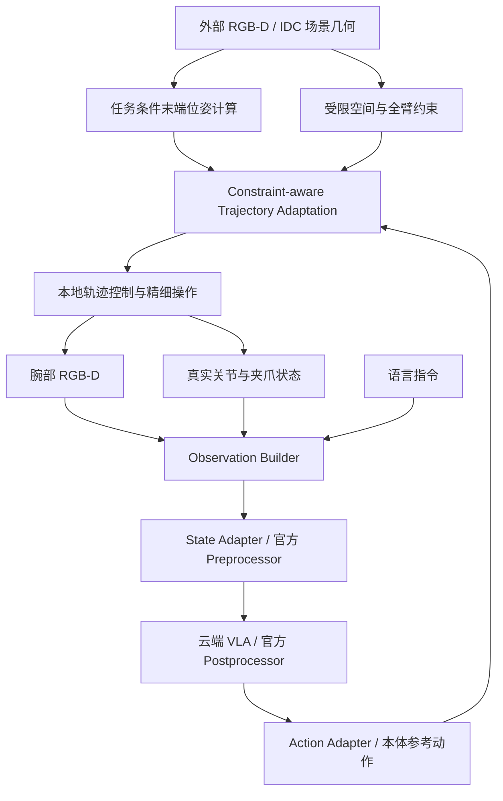

# PROJECT_CONTEXT — IDC-VLA 项目研究纲领

> 更新：2026-11-26｜用途：新 Codex 会话、研究与工程协作的长期入口。
> 本文件定义研究目标和技术边界；环境见 [DEVELOPMENT_ENVIRONMENT.md](DEVELOPMENT_ENVIRONMENT.md)，最新进度见 [DEVELOPMENT_STATUS.md](DEVELOPMENT_STATUS.md)。目标架构与候选算法不是已实现成果。

## 1. 项目定位

- 正式题目：**VLA-based Robotic Arm operation upon network cables in IDC centre settings scenarios**。
- 研究对象：IDC 机柜中密集网线与接口形成的受限工作空间，利用 JetRover 机械臂执行 RJ45 网线插入、解锁及拔出。
- 核心问题：如何结合 VLA 的任务意图、机器人运动学和三维环境约束，使机械臂能够达到合适的操作位姿、避免全臂碰撞，并完成对位置、角度和插拔行程要求较高的操作。
- 最终交付：实际可运行的 VLA 引导规划方法、真实系统、定义明确的场景对比实验及经验证的优化结果。

本项目不是单纯实现 VLA 推理、固定轨迹插拔、可达性可视化或通信系统。它们是支撑论文方法的基础工程，而非自动成立的算法创新。

## 2. 正式任务及研究优先级

| Task | 正式任务概要 | 原任务书目标日期 |
|---|---|---|
| 1 | 背景研究、机械臂操作、VLA 选型、通信方法与初步系统集成 | 2027-01-15 |
| 2 | 搭建机器人及网络平台，部署 VLA 并验证工作机制 | 2027-02-20 |
| 3 | 自由及复杂受限场景下的网线插拔，提出并验证轨迹规划方法 | 2027-03-30 |
| 4 | 四类工作空间实验、系统性能分析与优化 | 2027-04-30 |

日期来自早期任务书整理；Gantt 的部分分析条目延续至五月，实际期限以导师要求为准。最新 Student Specification 的中期目标包括 Task 1、Task 2 及初步工作空间与运动约束建模（文档标注 Task 3.1）。Stage 1 真实推理通过并不等于全部中期任务或 Task 2 已经完整验收。

早期学生 Outline 包含语义通信、视觉压缩和不同传输表示的比较。最新 Student Specification 以受限空间下的任务位姿及轨迹适配为中心；目前不将语义通信作为主要开发线，正式范围若需调整应以导师确认和最新任务书为准。

## 3. 两项核心研究方向

### 3.1 Task-conditioned End-pose Calculation

根据目标接口的三维几何、插拔方向、夹持关系、机械臂运动学和受限工作空间，计算适合完成任务的末端位置及姿态。

- 不能仅凭末端点位可达就认定任务可行：需要考虑全臂几何、候选路径、夹爪与线缆、关节限位、插拔行程及任务对准约束。
- JetRover 为五自由度臂，不能假设任意六维末端位姿均能实现；需要选择任务真正要求的姿态自由度，必要时调整候选位姿或返回不可行。
- 操作可划分为：无碰撞接近目标区域 → 以计算得到的可行操作位姿进一步接近 → 精细插入/解锁/拔出。第二部分是最新任务书强调的主要创新挑战。

### 3.2 Constraint-aware VLA Trajectory Adaptation

将 VLA 产生的、已明确物理语义的参考动作转换为本体轨迹，并在尽可能保留任务意图的条件下进行约束适配。

- 显式考虑关节可行域、全臂碰撞、环境间隙、动作连续性和任务位姿/行程约束。
- 候选方法包括参考轨迹修正、约束优化、候选轨迹选择、局部重规划等；具体算法仍待文献研究和实验决定。
- 不能把对未知 native action 的任意缩放、常规 RRT/IK 或碰撞拒绝直接称为论文创新。两项贡献需要独立对照与消融验证。

## 4. 目标系统架构

这是一种候选模块关系，末端位姿计算与规划可交互迭代，不要求严格串行。外部 RGB-D 提供全局三维几何，腕部 RGB-D 提供局部视觉反馈；当前已验证的是单台 D405 腕部 RGB 输入的真实推理链路，双相机、精细控制及真实规划闭环仍待完成。深度及 CameraInfo 主要用于后续几何研究，不应无依据改成模型必需特征。

当前基座为官方 SmolVLA Base。输入/输出适配、目标机器人数据采集和必要后训练是建立可信基线的工程工作，不预设必须改变模型网络结构或动作头。模型选择与训练方式由证据决定，避免为了换模型而重做硬件和通信模块。

## 5. 评价与实验设计原则

| 实验 | 目的 |
|---|---|
| 传统确定性控制/规划基线 | 区分 VLA 的贡献和已有控制能力 |
| 自由空间 VLA 基线 | 验证目标机器人策略具备基本任务能力 |
| 四类定义明确的工作空间 | 评估从开放到受限条件下的任务可行性、成功率及效率 |
| 相同 VLA + 末端位姿模块 / 轨迹适配模块 / 完整方法 | 候选消融方案；固定训练模型、测试条件与基础安全机制 |
| 优化前后对比 | 基于实际失败原因验证改进效果 |

任务成功率、插拔结果、执行时间是优先指标；可进一步记录规划成功率、路径长度、间隙、对准误差、重规划次数、延迟等。四类空间的精确定义、试次数和成功判据需在实验设计时冻结。旧仿真结果不能代替真实安全或任务成功证据。

## 6. 开发与研究原则

1. 优先复用已有模块，不平行重建驱动、通信、VLA 服务或规划框架。
2. 区分硬件名义配置、独立物理标定、模型训练语义、离线研究结果和真实实机验证。
3. 模型 native action 必须经过明确单位、通道、动作语义和时序核验后才能进入适配；适配后仍需独立执行校验。禁止把六维直接当作六个舵机命令。
4. 保留原始数据、版本、实验条件和失败试次。未知项写 UNKNOWN；未运行写 NOT_RUN；有条件通过不等于无条件通过。
5. 将论文方法与工程基础模块解耦。每轮按用户给定的任务边界推进，不因未来可能用到而提前扩展功能。
6. 文档组织见 [DEVELOPMENT_STATUS.md](DEVELOPMENT_STATUS.md)；实际操作命令与凭证管理见环境文档。

## 7. 依据与维护

研究范围以用户提供的最新 `ZhuSiyuan_2023213398_Spec.docx` 为优先依据；较早的 `IDC_VLA_Project_Specification_and_Research_Context.md`（2026-11-02）作为正式任务日期、历史范围和候选思路的补充。原始任务书含个人资料，不必上传公共仓库；本文件只保留必要研究信息。两项研究贡献为当前研究方向，未宣称新颖性或实际性能已经证明。项目目标变更时更新本文件，日常开发状态更新到 STATUS。
