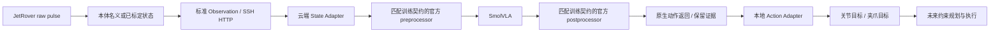

# SmolVLA → JetRover 状态与动作适配分析

> 2026-11-26｜基于 AutoDL 实际 checkpoint 文件输出、JetRover 本体资料与固定版本 LeRobot 源码｜不执行实机动作

## 1. 核心结论

- JetRover 与 SO-100 均可按五个臂关节和一个夹爪表示，关节功能顺序基本一致，直接关节空间适配值得优先研究。
- AutoDL 已有 `lerobot/smolvla_base` 权重及处理器文件，不需要重新下载整个模型。
- **最高优先级问题不是 rad→degree，而是归一化统计缺键及错误的特征绑定。** 当前文件仅保存 SO-100 三组动作统计，缺少 `observation.state` 统计，且没有处理器查找的 `action` 键；固定版本代码会静默跳过缺键转换。
- 不得通过重命名任意一组统计、使用动作统计代替状态统计、修改 robot_id 或把模型输出直接乘常数来声称完成适配。
- 建议先对实际运行处理器做离线数值验证，然后判断能否恢复可追溯的 SO-100 训练契约。若不能，应采用 JetRover 示教数据微调，建立自己的状态、动作与统计参数。

## 2. 证据与审计边界

本次读取用户上传的 `粘贴的 Markdown (1)(4).md`（AutoDL config、pre/postprocessor、README、两个 safetensors 的实际打印结果）、`servo_controller.yaml`、`jetrover_description.zip`；参照项目已有 `03_Action_Space_and_Robot_Adaptation(1).md` 与 Stage 1 代码/实验记录。

历史部署：checkpoint `lerobot/smolvla_base`，revision `5e8d12a6e2975b0e5e5fce7c8caf47c371d257b6`；LeRobot `ff0acf5ee6434369eeeb9d26e76d1e2ddc20c0d2`；实验客户端和云端源码 `95621ed`，总结检查点 `e77fa3d`。本次没有直接登录 AutoDL 或运行 GPU，只审计导出内容和对应源码；尚未复核当前实际权重/receipt 哈希、处理器实例运行状态及旧52次推理实际 Tensor。因此，归一化跳过属于有明确静态代码依据的高置信判断，仍须在服务器复现后才能认定历史实验每次都发生了该行为。

## 3. 实际 checkpoint 的模型契约

| 项目 | 实际配置 | 解释 |
|---|---|---|
| type | smolvla | 官方基础策略 |
| observation.state | [6] | 六个输入状态数值，配置未附通道物理名称 |
| action | [6] | 每个动作步六维，配置未定义物理单位 |
| n_obs_steps | 1 | 单次观测步 |
| chunk_size / n_action_steps | 50 / 50 | 原生预测50步，不代表实机必须一次执行50步 |
| max_state_dim / max_action_dim | 32 / 32 | 模型内部最大维度，不表示机器人32自由度 |
| camera1/2/3 | [3,256,256] | 三个声明的视觉特征；Stage 1 只实际绑定一台D405 |
| resize_imgs_with_padding | [512,512] | 模型官方图像处理配置 |
| VISUAL / STATE / ACTION | IDENTITY / MEAN_STD / MEAN_STD | 声明的归一化模式，是否真正生效需要验证 |
| adapt_to_pi_aloha | false | 未开启 PI-ALOHA 专用转换 |
| use_delta_joint_actions_aloha | false | 未开启 ALOHA 专用 delta 选项，不能据此证明全部训练动作均是绝对角度 |
| num_steps | 10 | 模型生成过程参数，不是舵机控制步数 |
| min_period/max_period | 0.004 / 4.0 | 模型内部配置，不是物理执行周期或控制频率的证据 |
| backbone | HuggingFaceTB/SmolVLM2-500M-Video-Instruct | 视觉语言骨干 |
| freeze_vision_encoder / train_expert_only / train_state_proj | true / true / true | 当前 checkpoint 记录的训练配置，可作为微调起点，实际冻结参数需复核 |

模型卡明确定位为面向目标用例进一步微调的基础模型，不能将其当作已经训练好 RJ45 插拔的 JetRover 专用策略。`50×6` 只证明输出结构，不能证明六通道已经是 JetRover 可执行目标。

## 4. 归一化统计：本轮最重要的发现

两个 safetensors 文件的打印内容完全一致，各包含6个长度为6的 Tensor，分别为以下三组 `*.buffer.action.mean/std`。下表保留三位小数以便阅读，精确值以服务器文件为准。

| 统计组 | action mean（通道0–5） | action std（通道0–5） |
|---|---|---|
| so100-blue | [1.421,125.721,125.419,63.783,-106.540,3.348] | [14.082,39.431,18.238,23.490,38.111,5.048] |
| so100-red | [2.439,124.938,123.558,66.993,-103.877,2.891] | [14.299,42.772,18.876,21.652,33.534,4.478] |
| so100 | [1.596,119.944,109.770,56.706,-27.423,12.003] | [26.392,52.411,49.854,36.998,59.360,19.040] |

### 4.1 文件直接证明了什么？

这些统计键明确关联 SO-100 命名的三个组，支持 SO-100 本体相关的预训练证据，但不能证明所有预训练数据只包含这些机器人或通道统计就是某一台实际机器的标定参数。数值尺度不像直接采用普通 rad；然而单凭均值不能确定角度单位、零位偏置、旧版电机归一化或具体控制语义。

- 两个文件均没有 `observation.state.mean/std`。
- 两个文件均没有无前缀的 `action.mean/std`。
- 两个文件均只有 action 统计，不能视为同一组同时适用于 state。
- blue、red、so100 的统计分布明显不同。例如第4通道的均值分别约 -106.54、-103.88、-27.42；没有依据任意挑选其中之一。
- preprocessor JSON 声明的视觉键为 `observation.image`、`observation.image2`、`observation.image3`，config 使用 `observation.images.camera1/2/3`，rename_map 为空。该差异需核对实际绑定；由于 VISUAL 为 IDENTITY，不能据此单独判定图像处理错误。Stage 1 已有单相机成功 forward 证据，尚无训练视角匹配证明。

### 4.2 为什么官方处理器可能没有真正归一化？

已直接核对项目固定 LeRobot revision 的 [`normalize_processor.py`](https://github.com/huggingface/lerobot/blob/ff0acf5ee6434369eeeb9d26e76d1e2ddc20c0d2/src/lerobot/processor/normalize_processor.py)：

- L227–244：`load_state_dict` 使用 `flat_key.rsplit('.',1)`，因此 `so100.buffer.action.mean` 被加载到 `_tensor_stats['so100.buffer.action']['mean']`。
- L269–288：观察归一化按 feature 名称查找，例如 `observation.state`。
- L290–303：动作归一化/反归一化固定传入 `ACTION`（标准动作键）。
- L332–334：如果 mode 为 IDENTITY **或者统计键不存在**，直接返回 Tensor。
- L352–365：仅当正确统计存在时才执行均值/标准差转换。

因此在项目使用默认 checkpoint processor、没有其他 stats override 或重新绑定的前提下：

```text
state 输入：observation.state → 查不到该统计键 → 原样通过
动作输出：action → 查不到该统计键 → 原样通过
```

现有 `FeatureObservationAdapter` 把六路名义 rad 作为 `observation.state`，`SmolVLAPolicyAdapter.start()` 只传入设备 override，`predict()` 调用官方 preprocess → predict_action_chunk → postprocess；没有显式的本体统计绑定。固定版 `prepare_observation_for_inference` 把 robot_type 作为字段保存，但上述统计查找本身并不据此选择 SO-100 组。单纯把 robot_type 改成 so100 既不保证修复，也会错误标注 JetRover 来源。

上游已公开讨论相同类型的迁移问题：[LeRobot issue #4415](https://github.com/huggingface/lerobot/issues/4415)、[#2374](https://github.com/huggingface/lerobot/issues/2374)。这是对风险的旁证，不代替本版本实际运行验证。

### 4.3 对 Stage 1 的影响

此前52次推理全部成功、动作有限且 shape 正确，仍然证明真实端到端数据链路已通。但调用 postprocessor 不等于完成实际反归一化；此前输出很可能是未反归一化的模型输出，而非 SO-100 物理动作。不能据此评估动作幅度、关节目标合理性或 RJ45 任务能力。历史数据不删除、不重标物理单位；如后续离线重跑，应记录新的处理器身份并与旧实验分开保存。

## 5. JetRover 与 SO-100 的本体对应

SO-100 参考通道来源：[官方 pickplace 数据集 meta/info.json](https://huggingface.co/datasets/lerobot/svla_so100_pickplace/blob/main/meta/info.json)、固定版本 [SO follower 驱动](https://github.com/huggingface/lerobot/blob/ff0acf5ee6434369eeeb9d26e76d1e2ddc20c0d2/src/lerobot/robots/so_follower/so_follower.py)。这套顺序是有依据的**候选对应**，不是当前 base checkpoint 六通道的完整训练契约。

| 模型候选顺序 | SO-100 | JetRover | ID | 对齐情况 |
|---:|---|---|---:|---|
| 0 | shoulder_pan | joint1 | 1 | 底座旋转功能对应 |
| 1 | shoulder_lift | joint2 | 2 | 肩部俯仰功能对应 |
| 2 | elbow_flex | joint3 | 3 | 肘部俯仰功能对应 |
| 3 | wrist_flex | joint4 | 4 | 腕部俯仰功能对应 |
| 4 | wrist_roll | joint5 | 5 | 腕部旋转功能对应 |
| 5 | gripper | r_joint | 10 | 夹爪功能对应，开口关系待定 |

固定版本 SO follower 驱动使用 Present_Position 读取状态、Goal_Position 写目标，臂关节根据 use_degrees 选择 DEGREES 或 RANGE_M100_100，夹爪为 RANGE_0_100。它支持绝对位置目标，但不能据此直接认定历史多数据集 base checkpoint 的所有动作标签都采用此版本定义；训练数据集和采集版本需要核对，尤其旧版关节 frame 可能不同。

两者关节功能相同不意味着相同角度产生相同 TCP；连杆长度、旋转轴局部方向、机械安装零位、夹爪结构及相机视角可能不同。具体本体数值见配套 `01_JetRover_Body_State_Action_Analysis.md`。

## 6. 建议的适配架构



本地上传保持机器人自身名义/标定单位和真实来源，不在串口驱动内做模型统计归一化。模型相关单位与关节映射放云端 State Adapter；官方 pre/postprocessor 负责统计归一化，不重复手工 scaler。输出适配留在本地，未来与规划模块连接，当前执行保持关闭。

### 6.1 若能够取得可验证的源机器人契约：直接映射作为基线

设 JetRover 五关节为 q_J（rad），若已证实 SO-100 源状态是 degree，则候选变换为：

```text
s_SO[i] = sign[i] * (180/pi) * q_J[i] + offset_deg[i]
a_J[i] = sign[i] * (pi/180) * (a_SO[i] - offset_deg[i])
```

仅对已证明相同对应关系且为绝对角度的通道成立；sign/offset 必须有实际定义或标定依据，不预设为 +1/0。若源动作是增量、速度或末端位姿，必须重新定义映射，不能套用绝对位置逆式。夹爪单独使用经验证的单调映射，不能直接把 r_joint 的 rad 当 0–100 百分比。

模型统计处理（已知且匹配对应训练组时）：

```text
z_state = (s_SO - mean_state) / (std_state + eps)
a_SO = z_action * std_action + mean_action
```

**state 与 action 的统计应分别取得**，且正确绑定 `observation.state` 与 `action`。不能以动作统计冒充状态统计，也不能仅靠 round-trip 数学正确就宣称物理语义正确。输出应经过离线限位/轨迹检查；越界要报告，不可静默裁剪后当作模型适配成功。即使数值完全一致也仍需验证迁移能力。

### 6.2 如果 base 训练契约无法完整恢复：推荐 JetRover 后训练

官方基础模型本身面向微调。以 JetRover 的统一六维状态、目标动作、D405 图像与语言指令建立 LeRobot Dataset，用同一数据契约计算独立的 state/action 统计，官方训练流程中验证统计的正确加载并输出完整新 checkpoint。未来推理时使用该 checkpoint 绑定的 processor，而不是沿用上述三组 SO-100 动作统计。

建议先用少量受控示教做数据采集与训练流程 pilot，正式数据量根据任务覆盖和学习曲线决定。记录实际反馈与控制器下发目标的区别、时间关联、任务和 episode；训练/验证/测试按完整 episode 或场景划分。当前不具备可信反馈、物理标定和实机执行准入时，不开始自主运动或将不可信观测当作正式标签。

这种方案避免把跨本体运动重定向变成新的科研负担；模型的本体适配属于基础设施，论文重点仍是任务条件末端位姿与受限轨迹修正。关节功能对应可保留为零样本迁移基线，但不是必须完成的硬件实验。

## 7. 下一步：只做一次模型处理器审计

下一轮交给 Codex 的目标为**只读核对实际云端 processor 的有效统计和实际前后变换，然后提交一份输入输出契约及直接映射可行性结论**。不立即重构或训练。

### 7.1 云端具体核查

在既有 Python 环境及固定 LeRobot checkout 下复用实际 `server.yaml`、模型 config、`make_pre_post_processors` 调用方式：

1. 核对实际 checkpoint revision/receipt、运行源码 revision、官方模型和 processor 文件哈希；确保未加载其他模型或覆盖统计。不要重新下载权重或升级依赖。
2. 逐个输出 processor step 的类型、features、norm_map 及 `_tensor_stats.keys()`；明确 `observation.state` 和 `action` 是否实际存在，记录统计来源与 override。
3. 使用离线探针记录 preprocessor 前后六维 state，以及 postprocessor 输入输出。例如对 action 使用 `[1,50,6]` 的全零和非零 Tensor，比较是否原样返回；真正的 mean/std 反归一化应将零向量转换成所绑定的 mean。测试不需要机械臂，也不必重新启动 GPU 服务。不能只看 JSON 配置宣称通过。
4. 查询 checkpoint 的训练历史、旧迁移版本及 SO-100 数据集/采集代码，找到 state 与 action 分别对应的通道、单位、零位、动作类型、统计组和 fps。对旧版或不同数据集的定义保持版本区分。若无法取到可靠证据，标记 UNKNOWN，不自行补全。
5. 如能恢复确切匹配的统计，创建独立、版本化的离线研究配置，保留旧文件和日志；用相同已记录输入对比处理前后数值（明确 recorded_replay，不冒充 live），验证范围及语义。不得覆盖正式控制配置或启用动作执行。

### 7.2 验收结果应回答的三个问题

| 问题 | 当前答案 |
|---|---|
| JetRover 与 SO-100 关节功能能否对应？ | 能，候选顺序基本对应；方向/零位与物理精度待验证 |
| 现有 base checkpoint 是否具有可直接使用的完整 state/action 契约？ | 目前不能证明，统计键缺失/错配必须先核查 |
| 是否可以立即开发真实动作映射？ | 不可以；先完成离线处理器验证，若无法恢复契约则准备 JetRover 后训练 |

**本轮不做：** 真实 VLA 动作执行、底层通信重写、手眼/TCP 标定、复杂 IK 重定向、工作空间规划算法开发、盲目改统计或直接缩放输出。

## 8. 参考链接与源文件定位

- 本地证据：用户上传 `粘贴的 Markdown (1)(4).md`，模型 config（L13–205）、preprocessor（L205–379）、postprocessor（L379–443）、README（L443–739）、统计打印（L763–791）；`servo_controller.yaml` L2–63；`jetrover_description.zip`。
- [官方 SmolVLA checkpoint](https://huggingface.co/lerobot/smolvla_base)；[模型论文](https://arxiv.org/abs/2506.01844)；[官方微调说明](https://huggingface.co/docs/lerobot/main/smolvla)。
- [项目 Observation Adapter](https://github.com/woruqingshan/Cable_robot/blob/e77fa3d/vla_server/src/vla_server/observation_adapter.py)；[SmolVLA policy](https://github.com/woruqingshan/Cable_robot/blob/e77fa3d/vla_server/src/vla_server/policies/smolvla.py)；[Action Adapter](https://github.com/woruqingshan/Cable_robot/blob/e77fa3d/cable_robot_vla/cable_robot_vla/action_adapter.py)；[Stage 1 实验总结](https://github.com/woruqingshan/Cable_robot/blob/e77fa3d/docs/real_operation/STAGE1_DEVELOPMENT_SUMMARY.md)。
- [固定版本归一化源码](https://github.com/huggingface/lerobot/blob/ff0acf5ee6434369eeeb9d26e76d1e2ddc20c0d2/src/lerobot/processor/normalize_processor.py)；[固定版本 SO follower](https://github.com/huggingface/lerobot/blob/ff0acf5ee6434369eeeb9d26e76d1e2ddc20c0d2/src/lerobot/robots/so_follower/so_follower.py)；[SO-100 示例数据集](https://huggingface.co/datasets/lerobot/svla_so100_pickplace/blob/main/meta/info.json)。
