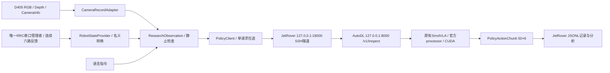

# Stage 1 系统使用说明

2026-11-24。用途是静止场景下的真实输入推理与动作记录，不是自主控制。

## 架构



没有从F到控制器的连接。RGB输入VLA；Depth和CameraInfo独立保存在本地。

## 数据格式及来源

### 相机

|用途|话题|类型/格式|
|---|---|---|
|RGB|/d405/wrist/color/image_rect_raw|sensor_msgs/Image，rgb8，848×480，step=2544|
|Depth|/d405/wrist/depth/image_rect_raw|sensor_msgs/Image，16UC1，848×480|
|内参|/d405/wrist/color/camera_info、/d405/wrist/depth/camera_info|sensor_msgs/CameraInfo|

配置30FPS；连续联调的RGB订阅实测约28Hz，不能把配置帧率当成实测。QoS使用sensor_data。源header、光学frame_id、编码和CameraInfo完整保存；驱动header的真实设备采样语义仍未验证。Depth为原始16位值，深度单位尚未通过本轮参数查询确认，禁止默认当成毫米。alignment=false，未证明RGB/Depth已对齐。

RGB复用CvBridge显式转换，再RGB8/PNG编码与SHA256校验；没有重新开发驱动或模型图像归一化。Depth保留PNG原始值。相机固件5.15.1.55，ROS wrapper4.55.1，librealsense2.55.1。

### 状态

|Servo ID|名称|角色|
|---|---|---|
|1–5|joint1–joint5|五个臂关节|
|10|r_joint|独立夹爪，不是joint6|

原始Pulse是当前读回数据，不是目标缓存。名义转换来自`/home/ubuntu/ros2_ws/src/driver/servo_controller/config/servo_controller.yaml`：比例240°/1000Pulse，逐关节使用init、min/max方向，不能统一假设零位500。配置哈希随conversion_evidence保存。单位rad仍为厂商名义值，夹爪不是开口米数。

每路保存raw_pulse、TX/RX、主机请求开始及接收时间、外层校验、错误。source_type=unknown、inner_association_verified=false、physical_calibrated=false；没有把未证明的内层关联提升为可信实测资格。目标命令缓存未参与输入。

### Research Observation

完整、机器可读的实际Schema：[research_schema.json](experiments/stage1_e2e_20261124/research_schema.json)。实际完整请求：[样本](experiments/stage1_e2e_20261124/observation_samples/real_observation.json)。

|字段组|数据类型与含义|
|---|---|
|schema_version|整数1|
|request_id、session_id|唯一字符串；服务端和客户端关联|
|observation_seq、task_revision、state_revision|非负整数；观测序号、任务修订、真实反馈周期|
|robot_id、robot_profile_id、model_id|字符串身份，不能代替模型/硬件语义证明|
|scene_id、scene_sha256|未注册场景标识；全零hash表示未提供几何，不是场景已标定|
|instruction|实际语言指令字符串|
|joints|joint1–5、5个有限float、rad、主机组末接收时间代表值|
|gripper|r_joint、有限float、rad、实际主机接收时间；simulated/calibrated均false|
|images|一个RGB8 PNG：camera_id、frame_id、原始header时间、尺寸、哈希、base64|
|feedback_report|完整六路原始读取证据，包括逐路时间，不把它们声称为同时采样|
|conversion_evidence|六路名义角度、原始Pulse、配置哈希和物理标定限制|
|timing_evidence|本地接收年龄、图像/状态到达间隔；physical_synchronization_verified=false|
|source_profile|real_research_inspection_v1|
|simulated、physical_calibrated、execution_enabled、execution_allowed、canonical_observation_eligible|全部false|
|capture_mode|live或明确的recorded_replay；后者必须带replay_reference|

JSON/application/json，经既有codec、PNG校验和PolicyClient传输。单样本约594KB，具体每次大小保存在inference_requests.jsonl；模型输入只有RGB、5+1名义状态和指令，不额外拼接深度。

研究检查只接受完整、无错误的当前外层反馈及不超过0.5秒的本地接收年龄。逐路原始host_monotonic区间不变；相机保持原始header时钟，两个时钟域不伪装为同域。图像选择最近已保存样本，匹配质量逐次记录，不宣称动态精密同步。旧正式Observation的0.5秒/20ms及可信来源规则不变；/v1/infer不能接收此独立Schema。初期目标2Hz，实际约1.39Hz，不补造样本。

### Action

响应仍为既有PolicyActionChunk：identity回显、action_id、policy版本、native_action_space、channel_names、units、semantics、shape、values、time_offsets_s、horizon和inference_duration_s。本轮shape=[50,6]、values为50×6有限float、native_0..5、model_native_unknown、semantics=unknown。官方postprocessor处理后的原生输出，尚不是JetRover关节命令。offsets不是已验证物理控制时序。

PolicyClient校验身份、超时和重复响应；单请求在途，ROS采集不等待HTTP。完整动作保存在每个run的inference_responses.jsonl。不得输入ActionAdapter或servo/controller。

## 启动和运行顺序

### JetRover环境及一次构建

```bash
ssh ubuntu@100.70.140.51
cd /home/ubuntu/zsy_projects/Cable_robot
git status --short --branch
source /opt/ros/humble/setup.bash
source /home/ubuntu/ros2_ws/install/setup.bash
unset LD_PRELOAD
export PYTHONPATH="$PWD:$PWD/cable_robot_vla:$PWD/cable_robot_control:$PWD/vla_protocol/src:$PWD/vla_server/src:${PYTHONPATH:-}"
```

代码只在feat/real-operation-pipeline。工作区有未提交文件时先保存、检查，不能reset/clean。相机包本轮实际构建命令（路径已存在后用于增量构建）：

```bash
colcon --log-base /tmp/stage1_camera_build_logs build \
 --base-paths camera/ros2/d405_bringup \
 --build-base /home/ubuntu/zsy_projects/stage1_camera_build \
 --install-base /home/ubuntu/zsy_projects/stage1_camera_install
source /home/ubuntu/zsy_projects/stage1_camera_install/setup.bash
ros2 launch d405_bringup d405.launch.py
```

只在需要构建或更新包时构建；每个新终端加载setup。启动前检查已有相机节点；已有`idc-stage1-d405.service`时直接复用，禁止重复启动。实际实验使用systemd-run以同一命令启动并保留日志：`journalctl -u idc-stage1-d405.service`。

### 只读硬件反馈

实际运行固定包：`/home/ubuntu/zsy_projects/real_operation_deployments/r1_f1_73aafa9ecac071206f17afb095eb938e5a56a670/run_feedback.py`。默认20Hz、唯一Board，运动权限未授权，继续复用已审核补丁；原厂文件未修改。

启动前必须按已有[R1维护方案](R1_SDK_MAINTENANCE_PLAN.md)确认静止/监督、RRC身份1a86:55d4/5A25000846、实时原驱动PID及串口所有者。原厂驱动若已运行，不能直接再启动反馈进程。经过授权后，设置本次开机的start_app_node Restart=no，再只向已核验原驱动发送SIGTERM，确认串口释放。不能重启bringup，也不能把文档里的旧PID复制执行。

已确认串口无人使用后，本轮实际执行的启动方法：

```bash
sudo -n systemd-run --unit=idc-stage1-feedback --uid=ubuntu \
 --property=Restart=no --property=KillSignal=SIGTERM \
 --property=TimeoutStopSec=15 --property=SendSIGKILL=no \
 --setenv=PYTHONDONTWRITEBYTECODE=1 \
 /bin/bash --noprofile --norc -c \
 'source /opt/ros/humble/setup.bash; source /home/ubuntu/ros2_ws/install/setup.bash; exec /usr/bin/python3 -B /home/ubuntu/zsy_projects/real_operation_deployments/r1_f1_73aafa9ecac071206f17afb095eb938e5a56a670/run_feedback.py'
```

已有同名服务时先检查并复用，不能为消除错误擅自重启。`/idc_vla/real/feedback/status`用于检查valid、gate.error、motion_permission=false；状态发布约10Hz，与底层20Hz轮询不同。进程active不等于反馈有效。标准控制接口维护期间停用。

Restart=no位于/run，重启即消失；它防止原驱动自动回来抢串口。不是永久修改原厂启动方式。重启后的串口拥有者、服务状态必须重新核对。

### AutoDL

```bash
ssh -p 46118 root@connect.bjb1.seetacloud.com
cd /root/autodl-tmp/idc-vla/Cable_robot
source /root/autodl-tmp/idc-vla/runs/bootstrap/use_proxy.sh
```

本轮历史代理的实际启动路径是`/root/.local/bin/mihomo -d /root/.config/idc-vla-mihomo`；先检查是否已运行，不重复启动。用户另有`~/bin/mihomo -d ~/.config/mihomo`，只有对应文件实际存在且端口匹配时使用；不要读出订阅密钥。`source /etc/network_turbo`为备选，本轮未用它验收。

```bash
git fetch origin feat/real-operation-pipeline
git switch --detach <已审核SHA>
export PYTHONPATH="$PWD:$PWD/vla_protocol/src:$PWD/vla_server/src:$PWD/cable_robot_vla"
HF_HUB_OFFLINE=1 TRANSFORMERS_OFFLINE=1 \
 ../venvs/vla-model/bin/python -m vla_server.app \
 --config ../runs/stage1_20261124/server.yaml
```

已有云服务时先检查，不能启动第二个8000端口进程。配置仅127.0.0.1:8000，research_inspection_enabled=true，独立允许real_research_inspection_v1。旧synthetic配置未覆盖。Python3.12/PyTorch2.8.0+cu128，LeRobot固定ff0acf5ee6434369eeeb9d26e76d1e2ddc20c0d2；checkpoint在`../models/smolvla_base`，revision=5e8d12a6e2975b0e5e5fce7c8caf47c371d257b6。不重新下载、不改权重。

```bash
curl --noproxy '*' http://127.0.0.1:8000/health
nvidia-smi
```

health应ready、gpu_model_ready=true；首次推理前genuine_inference_verified可以false，实际forward后再确认。日志在`../runs/stage1_20261124/server.v2.log`，逐请求证据在diagnostics目录。不要公开暴露端口。

### 在JetRover建立隧道和执行推理

```bash
ssh -fN -o StrictHostKeyChecking=yes -o ExitOnForwardFailure=yes \
 -p 46118 -L 127.0.0.1:18000:127.0.0.1:8000 \
 root@connect.bjb1.seetacloud.com
curl --noproxy '*' http://127.0.0.1:18000/health
python3 -B deployment/local/stage1_inspection.py \
 --output /home/ubuntu/zsy_projects/real_operation_evidence/<新实验目录> \
 --seconds 30 --server-url http://127.0.0.1:18000 \
 --instruction 'Inspect the RJ45 cable and network port.'
```

SSH认证交互输入，不能写进脚本或环境配置。先云服务→隧道→相机→只读反馈→采集程序。程序先初始化传感器；每次新run目录不会覆盖旧数据。省略server-url即本地录制模式，不需要GPU。成功输出例如observations=42、responses=42；拒绝的构建不会上传。Ctrl+C结束采集客户端，不意味着反馈服务停止。

重连隧道前用`ss -ltnp`找到18000对应SSH进程，核对完整命令后只结束该隧道PID，再重建；不要pkill ssh。服务控制均针对本实验拥有的进程，不恢复整车控制或运动权限。

## 故障处理和退出

- RGB/Depth无数据：检查本实验相机服务日志、实际topic、QoS、encoding和尺寸；不要启动第二相机实例。Depth单位或外参未知时保留未知，不猜测几何。
- 反馈DEVICE_ERROR：保留独立fault_events.jsonl。未知Status、超时或错配后不盲目重试、不清空队列冒充恢复。人工恢复须现场授权和清空周边，正常关机后断电、确认控制板完全断电、再上电；随后按唯一所有者步骤重新启动只读反馈并验证30–60秒。原厂开机可能初始化，不能远程擅自执行这一流程。本轮验证了该人工流程，未验证自动恢复。
- 原厂开机恢复：/run维护保护重启后失效；重新核对拥有者，不直接启动第二Board。恢复原厂控制另行评估，不能把停止反馈等同于硬件状态已恢复。
- Observation无效：先看run/metrics.json。缺图像、陈旧图像、反馈失效、缺夹爪均拒绝；研究路径仍不接受缓存值。不要放宽正式20ms阈值。
- 隧道失败：先查18000监听和云端8000的/health；断网的请求单独报错，不积压或自动执行返回动作。
- GPU加载失败：查看startup_error和本轮云日志；核对固定模型、receipt、缓存和解释器，不临时pip升级或换模型。
- 动作异常：用请求ID及双端diagnostics核对，codec拒绝错误身份/形状/非有限值。原生单位未知，禁止“试着发给机械臂”。

名义零位、方向、夹爪物理量、URDF/FK、TCP、手眼和模型动作空间尚未完成标定。此链路不是可信自主控制闭环。真实故障的自动恢复、动态精密同步和长期无人值守仍未通过验收。

实验复现和统计：

```bash
python3 -B deployment/local/analyze_stage1_inspection.py <原始case目录> <新的分析目录>
```

需在case中放入对应的cloud_summary.json才能核对双端ID及CUDA同步计时。不要把RTT减去GPU耗时后剩余部分全部称为网络延迟。分析图中的native_0..5单位未知，横轴step不代表已经验证的控制时间。

## 最终运行状态（实验后）

人工恢复后的实时推理和30秒验证完成后，周期8675的ID1请求0x05发生READ_TIMEOUT（约101ms、无RX），系统PAUSED_NO_QUERY。独立证据已保存，未重试、未清锁、未自动恢复运动。当前反馈无效，motion_permission=false，进程仍存活；再次联调必须经明确的人工恢复边界，不能直接假设当前可采集。该状态不抹去已完成的52次实时推理，也不代表故障自动恢复已经解决。

本轮去重回归378 passed、1 skipped（PyKDL）；研究Schema针对性11 passed；云端4项ASGI边界断言通过。早期453/2统计含重复收集，不作为唯一测试数使用。云端pytest/httpx未安装，未为此升级环境。
