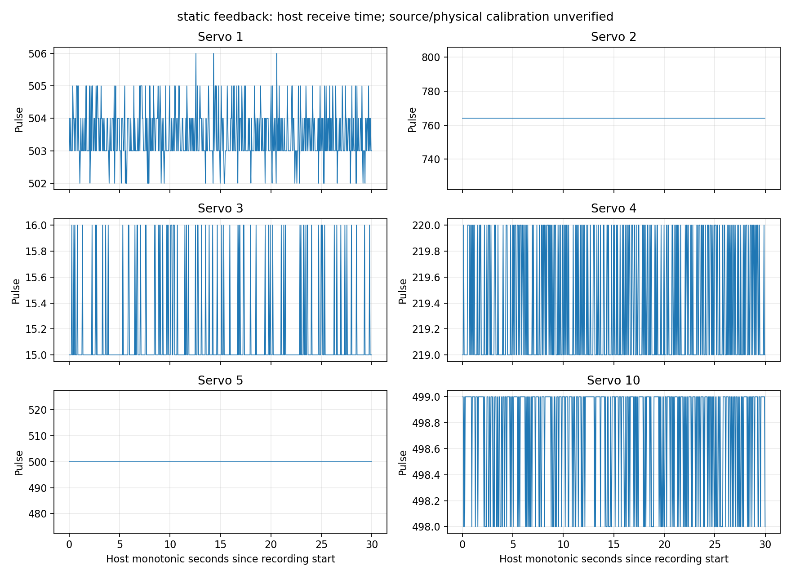
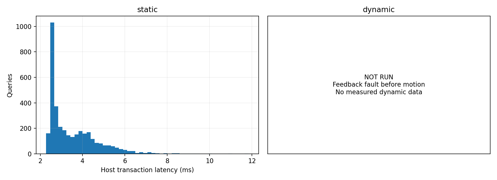
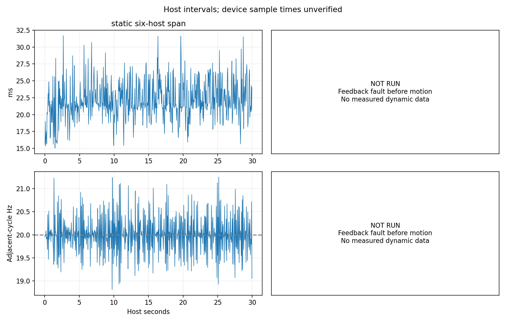
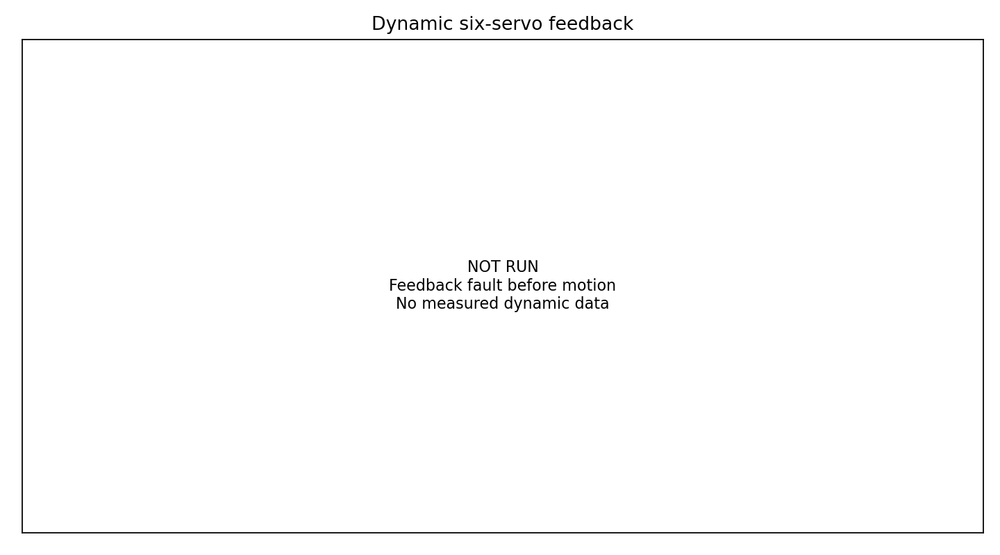
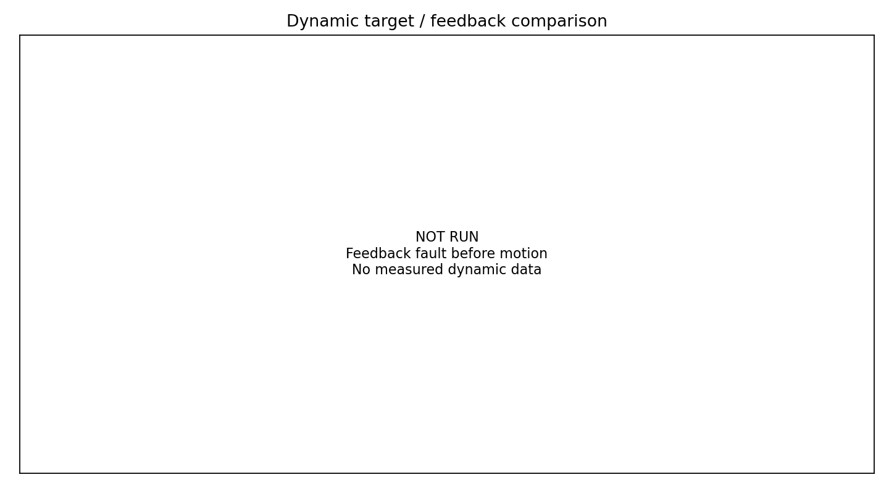

# 连续反馈实验报告：静态通过，动态因设备错误未执行

日期：2026-11-24，Asia/Shanghai。分支：feat/real-operation-pipeline。

**本轮R1 Final总体目标尚未通过。** 连续反馈、唯一串口驱动、独立录制及真实状态诊断
已实现；30秒静态实验通过。停录后按要求持续运行时，采集器进入DEVICE_ERROR，
动态前置检查拒绝继续。因此没有真实A→B→A运动，不能声称动态稳定性通过。

## 1. 实际结果与证据边界

**Confirmed**
- 静态记录600组、3600/3600有效外层回复；全部保存的TX/RX帧另作离线CRC、
  ID、Command、Length、Status和Pulse核验，3600对均一致。
- 停止记录后，采集仍继续运行；连续模块没有运行时长或总查询次数上限。
- 动态前看到gate=FAULT/DEVICE_ERROR，周期计数5995；后续被动观察保持不变，
  读取确实停止，串口仍由唯一进程持有。
- 错误发生在运动能力激活前，命令历史为空；没有A/B、Torque、夹爪或底盘动作。
- 未发生本轮USB重绑定/reset、固件刷写、bringup重启或系统依赖安装。

**Suspected**
- DEVICE_ERROR来自已部署ReadbackGate对RRC结果字段非零的处理；
  限定为“设备返回读回错误”，不是已定位的USB DTR超时、硬件损坏或固件缺陷。

**Unknown**
- 具体出错Servo ID、原始Status值和首次故障接收时刻未独立保全。
- 实际固件内层关联、迟到/重复回复边界和故障根因仍未确认。
- 实机运动与采集是否互相干扰、返回A误差、物理方向/ID对应，均未完成动态验证。

本次有证据缺口：旧运行包在停止记录后没有独立故障日志，错误帧未存盘。
不能靠猜测补齐，更不能再次查询来“重造”该故障帧。
已离线修补并通过模拟串口/真实ROS执行器验证，但未对故障现场重新部署。

## 2. 软件交付

- ContinuousFeedbackCollector：复用原SDK接收线程、原解析器和PositionCapture；
  默认20Hz，逐路事务串行化，有界锁/TX/RX，固定周期调度跳过积压。
- ExperimentalReadbackGate：独立重复实验入口，来源始终unknown；
  原可信路径KEY_REUSE_UNSAFE与旧有限诊断保护保留，不用实验成功替代关联证明。
- UnifiedFeedbackNode：一个Board/串口，普通运动入口仍关闭；
  只允许经审核、文件SHA绑定、起始姿态匹配的一次B然后A。
  位置读取与获准控制在同一工作线程的事务边界协调，停止请求优先。
- MotionPolicy/Monitor：复用既有Pulse/时长/软阈值检查；非参与执行器和Torque禁止；
  通信失效、突跳、明显冻结触发失效及参与关节停止，不自动返回A。
- FeedbackRecorder：独立有界异步CSV/JSONL记录；停止记录不停止反馈。
  队列/磁盘问题独立报告，不借清队列、sleep或自动重试掩盖通信异常。
- Real State Integration：复用RobotStateProvider、RawFeedbackAdapter和JointFeedbackConversion；
  输出/idc_vla/real/feedback_joint_states，unset采样时间戳，保留每路主机区间。
  正式目标缓存不被替换，未接入SmolVLA Observation。
- ArmInterface/FixedTrajectoryExecutor：复用现有移动与停止接口，增加显式arm-only
  和可中断等待；原默认夹爪完整性断言保留，arm-only模式拒绝夹爪目标。

静态的名义rad仍基于厂商配置；物理零位/方向/内部偏差、夹爪语义和设备采样时间未标定。
六路反馈不是已验证的六维SmolVLA动作语义，也不是闭环或物理安全认证。

## 3. Static / Dynamic 实测矩阵

|指标|Static|Dynamic|
|---|---|---|
|实际记录时长s|30.017889835|NOT_RUN|
|实际更新Hz（相邻首读起点）|19.998217746815442|NOT_RUN|
|完整组数/窗口秒|19.988080551232393|NOT_RUN|
|完整状态组数|600|NOT_RUN|
|查询次数|3600|NOT_RUN|
|外层回复成功比例|1.0|NOT_RUN|
|Mean latency ms|3.5095934483333333|NOT_RUN|
|P95 latency ms|5.716457|NOT_RUN|
|P99 latency ms|7.175272|NOT_RUN|
|Max latency ms|11.837745|NOT_RUN|
|平均六路主机跨度ms|22.118905745|NOT_RUN|
|P95六路主机跨度ms|26.88105|NOT_RUN|
|最大六路主机跨度ms|31.687296|NOT_RUN|
|不完整组数|0|NOT_RUN|
|跳过周期|0|NOT_RUN|
|返回原位误差|N/A|NOT_RUN|
|运动指令|0|0（前置反馈已失效）|

P95/P99使用nearest-rank；延迟是主机事务时间，不是设备采样时间。

|ID|静态Pulse范围|Pulse总体标准差|
|---|---|---|
|1|502–506|0.814451|
|2|764–764|0.000000|
|3|15–16|0.348708|
|4|219–220|0.480960|
|5|500–500|0.000000|
|10|498–499|0.451414|

## 4. 静态性能解释

请求20Hz，测得19.9982177468Hz；600组除以实际记录30.017889835秒为19.9880805512组/秒。
两种分母均保留。599个相邻周期首读起点的跨度为29.952669162秒，
比599×50ms多2.669162ms；调度lateness平均0.761889ms、最大3.535405ms。
没有跳过周期，最大六路跨度31.687296ms仍小于请求周期50ms。
这些实测边界解释了为何不能把频率写成精确20Hz；主机、USB、线程负载各自贡献未单独剖析。

平均六路主机跨度22.118906ms高于既有Observation同步阈值20ms。
即便频率达标，也不代表六路设备采样同步，更没有RGB同步证明；阈值未放宽。
相对以前低频小样本，单路延迟增加，不能仅凭差异断言是记录、USB带宽或某个硬件部件造成。
静态平坦曲线也不证明动态读回正确、无旧回复或已经是可信测量。

## 5. 动态准备与停止原因

用户已明确确认完整物理路径、现场监督和断电条件，批准一次具体往返：
ID1–4：A=[503,764,15,219]，B=[300,850,50,250]，每程4秒，各停留4秒。
B来自insert.yaml:CABLE_PICK_MIDDLE；ID5/10不发运动目标。
完整数值/停止审核见[动态方案](../../CONTINUOUS_MOTION_REVIEW_20261124.md)。

在运行前置检查时，状态消息已经是DEVICE_ERROR、valid=false；
没有进入arm_reviewed_motion、正式动态录制或目标发送分支。
错误存在于运动之前，不能将其归因于运动与读取争用。
动态持续时间、成功率、延迟、六路跨度及回位误差均NOT_RUN，不是0。

旧执行脚本将它笼统写作DRIVER_NOT_READY；清理阶段还发出ROS停止消息，
但驱动因没有运动能力拒绝，未下发串口动作。离线修补现在保留具体DRIVER_FAULT原因，
且只在确有运动发送可能时清理停止，不再无条件发停止消息。
当前根因只确认到软件锁存的设备错误，不能确定具体Servo ID、Status值或STM32问题。
没有为完成实验而删除保护、重发查询、重启驱动、清故障或强制回A。

## 6. 图表与文件

- [static_feedback.csv](static_feedback.csv)：3600条真实通道记录，含名义rad、原始TX/RX和主机时间。
- [static_metrics.json](static_metrics.json)：全部实测统计和每ID波动/延迟。
- [dynamic_feedback.csv](dynamic_feedback.csv)：仅列标题，无任何实测行，明确未运行。
- [dynamic_metrics.json](dynamic_metrics.json)：NOT_RUN，性能数值null，运动指令0。
- [evidence_summary.json](evidence_summary.json)：运行版本、故障证据、回归和软件修补状态。

后两张是NOT_RUN说明页，没有动态实测曲线，不能计作动态曲线验收通过。
没有把计划目标伪装成已执行轨迹，没有视频或动态物理参考可供验收。
绘图工具在将来有真实动态数据时可绘制目标端点与反馈；目标阶跃与物理运动曲线的差异
不能全部解释为通信延迟，板端实际插值未验证。

仓库CSV仅将CRLF换行为LF，已逐字段与封存原件比较一致；原始CSV未修改，
两种字节哈希均记录在evidence_summary.json中。

## 7. 测试、版本与实机状态

最终相关回归416 passed、2 skipped，27.30秒；缺PyKDL、FastAPI，两项未验收。
模拟串口配真实ROS执行器验证了：唯一Board、记录停止后继续、运动/停止报文协调、
故障停读，以及即使记录关闭也独立保存真实接收路径故障帧。Mock不是实机运动证明。
未为消除skip安装或升级依赖；未执行VLA或AutoDL请求。

Git检查点：

|提交|内容|
|---|---|
|404d9f3|独立连续实验采集器；原可信/有限保护保留|
|5b92875|唯一串口驱动、运动能力白名单及异步记录|
|a6c828c|真实状态记录、实测指标及静态测试工具；实际运行包来源|
|0e4ccbf|可中断arm-only轨迹与完整动态执行准备|
|94cd090|停录后故障留存、具体故障提示、停止清理修补；仅离线|

运行包：a6c828c3e6d26d41c1e94e401d42455739890e80，35文件清单SHA256：
0ebee2b5af7f7fa44772070e7d2620ac8e97a64736bdfc8d70caf6525eec0c12。
修补候选：94cd090d209e42f1b32d6addcaf06d68ff9ebc69，已准备新包但未部署、未打开串口。
结果文档提交不改变运行中的版本，不能用最新Git HEAD冒充实机加载版本。

当前idc-r1-continuous-a6c828c.service PID8413 active，唯一串口FD21；
这是进程仍在报告故障，采集线程已停，不能解释为反馈正常。
父服务PID853 active、Restart=no、NRestarts=0；按键代理PID834未重启；
ModemManager inactive/masked-runtime；正常运动控制未恢复。
原厂53份文件及备份哈希仍一致。当前反馈无效，不声称现在姿态已被重新测量。
运行时保护在重启后消失，不是永久禁止bringup初始化。

不自动关驱动、重开串口、恢复正常驱动或移除ModemManager屏蔽；
这些会改变串口/初始化状态，不能将Git回退当作硬件恢复。
下一步最小工作是在审阅故障恢复边界后，使用带独立故障留存的新包做受控恢复和采集，
先取得出错ID、Status和完整帧，再决定针对处理；目前没有证据要求刷写STM32。
动态实验须在真实反馈恢复、起始姿态及现场条件再次核对后继续。

原始证据目录：
/home/ubuntu/zsy_projects/real_operation_evidence/r1_continuous_20261124T055041Z/

R1 Final: PARTIAL_STATIC_PASS_DYNAMIC_BLOCKED_BY_DEVICE_ERROR。
Continuous trusted feedback: NOT_PROVEN。
Dynamic hardware motion: NOT_RUN。
R2 readiness: BLOCKED。
