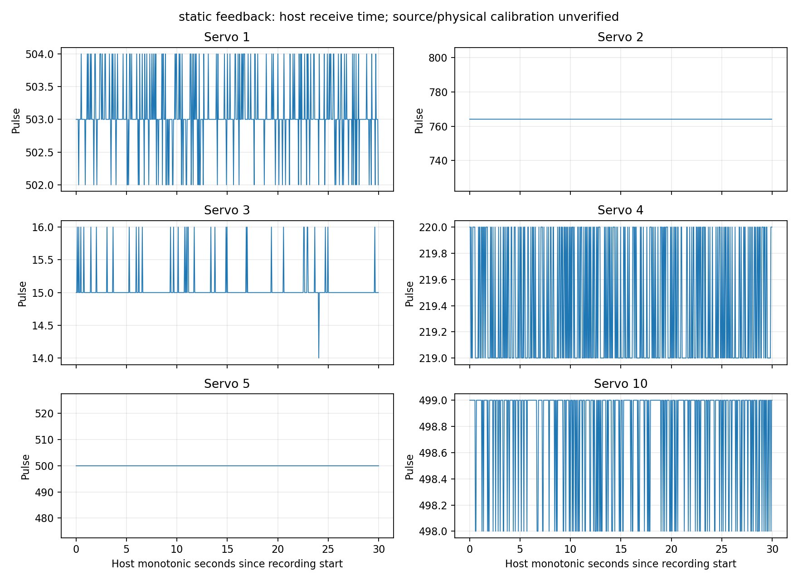
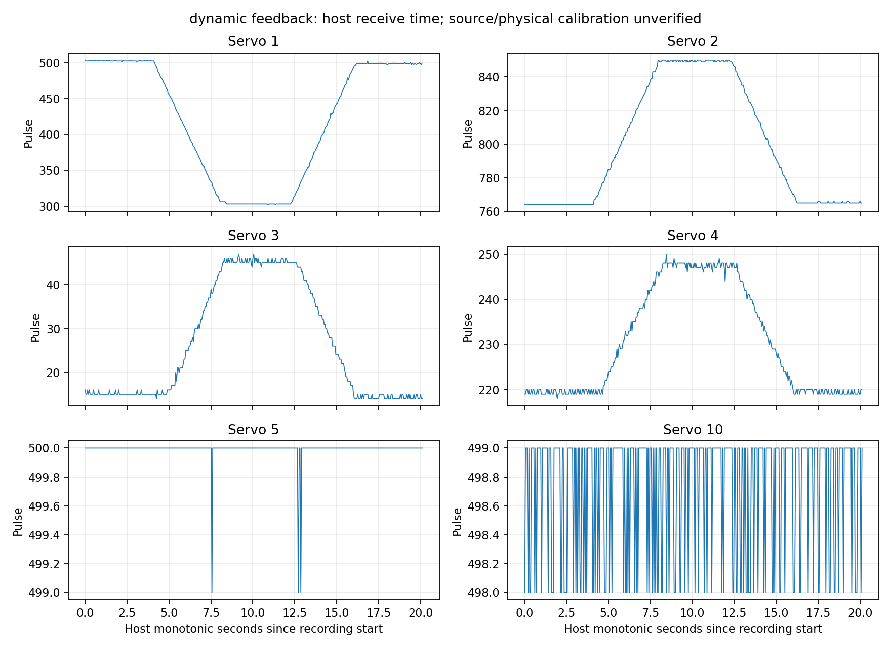
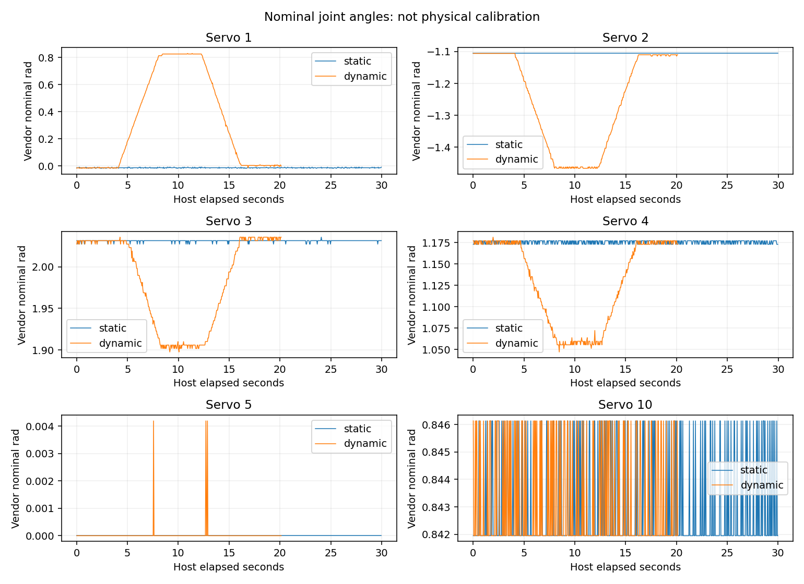
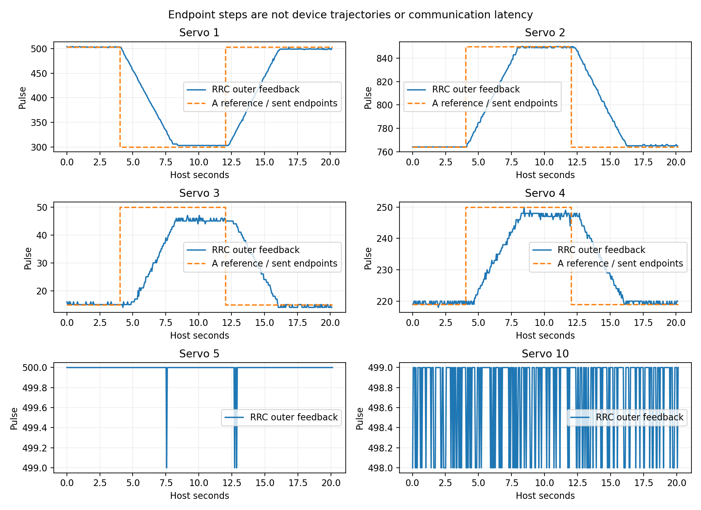
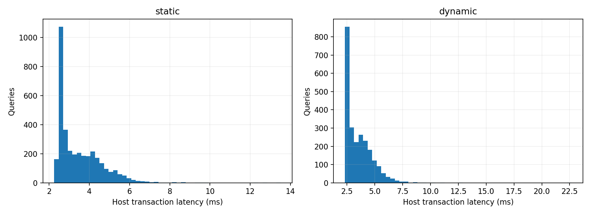
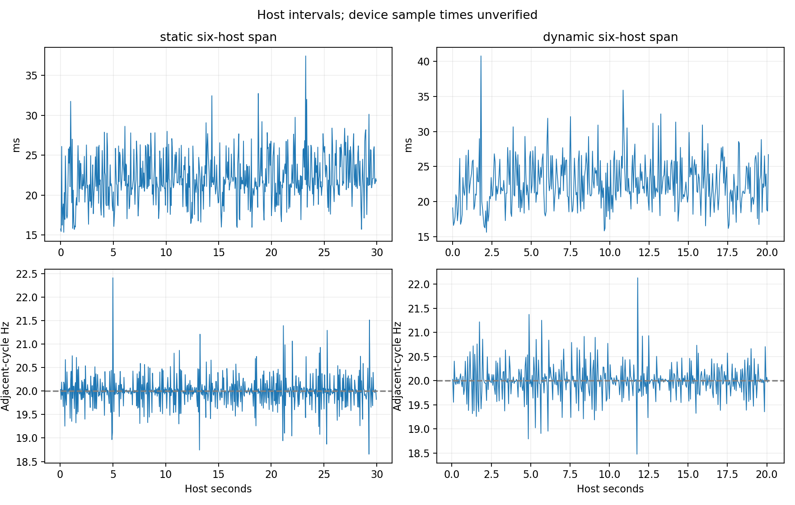
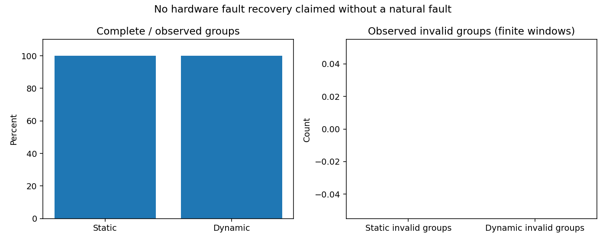

# R1-F1/F2/F3 联合实验报告

2026-11-24；feat/real-operation-pipeline。R1基础功能验收：PASS_WITH_LIMITATIONS。

## 容错机制

采集线程、数据有效性与运动权限独立管理。原可信路径KEY_REUSE_UNSAFE保留。
完整匹配且确认结束的失败回复可使单组无效后继续；终结Status必须配置已审阅语义引用，
默认列表为空，本车未知非零Status仍隔离，不盲目清队列、sleep或重试。
完整成功回复中的越界Pulse被拒绝，后续实验采集可继续；连续无效默认3次后暂停。
超时、错配、迟到、重复和严重I/O错误暂停查询，线程继续提供诊断和停止通道。
普通调度积压跳过，ROS慢消费者保留最新，记录错误不停止健康采集。
运动中数据无效撤销运动权限，反馈恢复不自动恢复运动；不强制返回A。
停止入口在暂停和主动停止采集后仍可调用；写失败或无设备确认时不保证送达。

复用94cd090独立故障留存：Status/ID/Command、TX/RX、CRC来源、长度、主机时间、
版本、周期、计数及恢复决策均保留。没有完整回复时未知字段为null，绝不补造。
模拟测试覆盖终结Status恢复、连续错误预算、越界、超时、错配、日志与停止路径。
两段正式录制窗口未出现DEVICE_ERROR；窗口外随后自然复现，详见下方追加故障。真实设备故障恢复为NOT_RUN，未知根因未解决。

## 实测矩阵

|指标|Static|Dynamic|
|---|---|---|
|实际时长s|30.013302642|20.156975264|
|更新Hz|19.999490548536635|19.999646693803562|
|完整组|600|403|
|请求数|3600|2418|
|有效回复|3600|2418|
|成功比例|1.0|1.0|
|Mean ms|3.5023437347222224|3.5832915690653433|
|P95 ms|5.529749|5.724359|
|P99 ms|6.706598|7.322175|
|Max ms|13.526119|22.675205|
|六路跨度Mean ms|22.087725533333334|22.630331362282877|
|跨度P95 ms|27.002393|28.294615|
|跨度Max ms|37.428511|40.790351|
|不完整组|0|0|
|跳过周期|0|0|
|正式窗口错误|0|0|
|真实故障恢复|NOT_RUN|NOT_RUN|

频率保留相邻起点与组数/窗口两种分母，分位数nearest-rank。
平均六路主机跨度约22ms，未满足旧Observation的20ms要求，不放宽或伪造采样时间。

完整运行状态快照还记录了录制窗口以外的1次周期跳过及1次record_errors计数；不能将正式窗口零错误扩展为全程零错误。录制错误的具体异常未被该计数保存，原因UNKNOWN；两次正式录制均complete=true、error=null，采集器继续健康运行。

## 真实运动及回位

|ID|初始中位Pulse|B中位Pulse|返回中位Pulse|相对初始误差|
|---|---|---|---|---|
|1|503|303.0|499.0|-4.0|
|2|764|850|765.0|1.0|
|3|15.0|45.0|14.0|-1.0|
|4|219.0|247.0|219.0|0.0|
|5|500.0|500.0|500.0|0.0|
|10|499.0|499.0|499.0|0.0|

初始取0–3s、B取9–11.5s、返回取18–20s中位数。完整原始每路数据保存。
A新测[503,764,15,219]，B取insert.yaml的[300,850,50,250]；仅ID1–4两次位置发送。
用户确认本轮路径、监督和停止条件并授权；每程4s，A/B各停4s，ID5/10只读。
用户独立现场确认完整往返，未见碰撞、卡顿、线缆牵扯、夹爪或底盘意外动作；未录视频。
ID1下降、ID2–4上升再返回，反馈为渐变而非命令阶跃；ID5/10约1Pulse内波动。
B段相对目标数Pulse偏差、ID3可见启动滞后，不能全部当成通信延迟或称精度已标定。
动态平均延迟略增，Max22.675ms、六路Max40.790ms仍小于50ms周期；无不完整组或跳过。
组合运动和各ID趋势通过；逐轴物理方向/零位、夹爪和URDF/FK标定留给R2-A。

## 试次及版本

首次前置检查遇到客户端授权发布滞后，0运动、0数据，失败文件dynamic_trial.json保留。
客户端加授权确认屏障；核验同计划SHA、健康反馈、空命令历史后使用尚未使用的有效能力。
成功试次是dynamic_trial_confirmed.json，403组；不是恢复已撤销运动，没有重启驱动。
正式静态与动态为同一进程、同一串口。未刷STM32、升级依赖或调用AutoDL/VLA。
运行包73aafa9ecac071206f17afb095eb938e5a56a670；客户端修补5b9423e。
最终回归424 passed、2 skipped，27.92秒（PyKDL、FastAPI未验收）。

source_type=unknown、physical_calibrated=false、设备采样时刻未知；Pulse→rad为厂商名义关系。
R1基础静动态功能通过，不等于通信绝对可靠、完整物理标定或可信闭环证明。
后续R2-A：零位/方向/偏差/限位、夹爪、URDF/FK、D405接入与时间匹配。
R2完整Observation和云推理本轮NOT_RUN；不提前开展VLA动作和工作空间规划。

## 图表

## 文件与当前状态

CSV只规范化换行，原始记录保留在/home/ubuntu/zsy_projects/real_operation_evidence/r1_f1_20261124T090956Z。
static/dynamic_metrics.json、fault_events.jsonl、motion_commands.jsonl、motion_analysis.json均随报告提交。
用户现场确认运动无异常；随后窗口外DEVICE_ERROR使查询暂停，进程仍运行，反馈无效且运动权限关闭；不恢复正常整车控制。
运行时Restart=no及ModemManager屏蔽继续保留，重启后失效。

## 录制结束后的自然故障（最终状态）

2026-11-24T17:38:44.350244+08:00，周期32810，ID10位置0x05收到外层完整CRC有效回复 `aa5505050a05ff0000cc`，Status=0xff（有符号-1），Pulse字段0被拒绝，未作为位置使用。ID1–5该组已返回，ID10失败使整组无效。

TX=`aa550502050a4f`。决策PAUSE_UNKNOWN_TERMINATION，无自动重试，进程存活但查询暂停、数据无效、运动权限关闭。故障发生于动态录制结束后约1074.5秒，记录器已停止；独立故障日志成功保全。

本车Status=-1的内层事务结束/迟到回复语义仍未验证，因此未放行恢复。不能归因为运动冲突，也不能宣称普通设备拒绝的实机恢复通过。R1静动态基础功能通过；无人值守长期连续性及真实故障恢复仍PARTIAL。后续最小工作为核对该失败状态与当前固件的终结语义，再评估有限恢复，禁止仅凭一次匹配回复删除保护。
