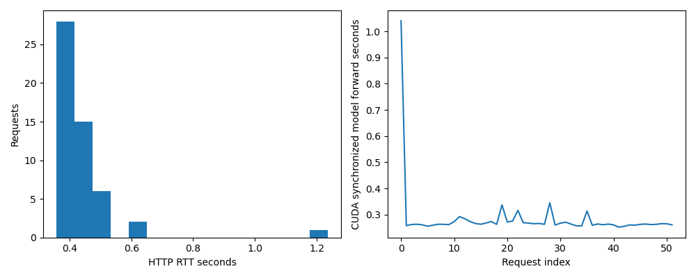
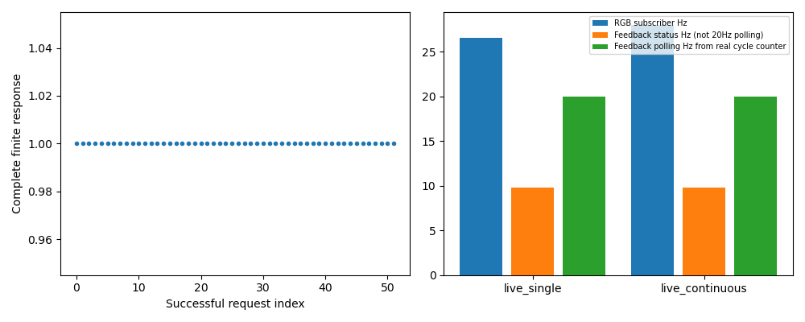
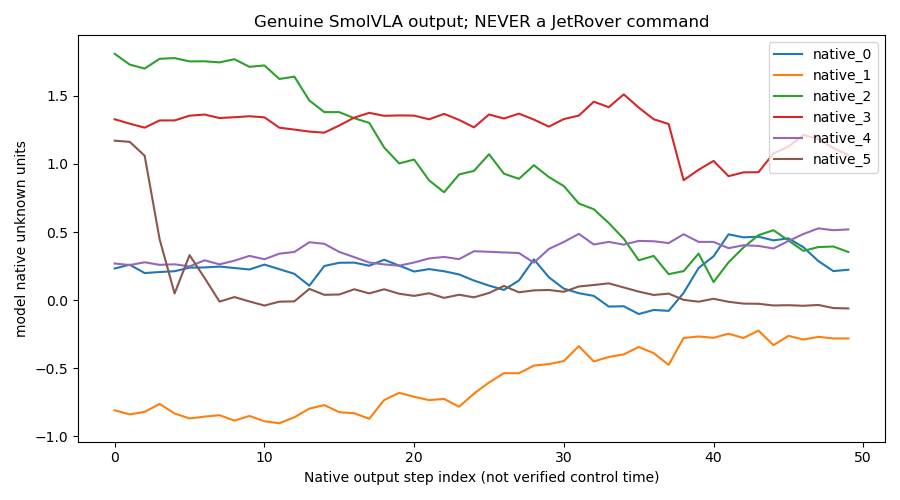

# Stage 1 真实Observation端到端实验

2026-11-24。结论：真实输入→真实GPU→本地完整动作记录 PASS_WITH_LIMITATIONS；持续运行恢复能力仍有限。

[正式使用说明](../../STAGE1_USER_GUIDE.md) · [开发总结/完整验收矩阵](../../STAGE1_DEVELOPMENT_SUMMARY.md)

52次live请求，双端ID对应，52次完整有限50×6输出，无动作执行。首批10次；约30秒连续段42次。全部来自当时真实D405图像和当时真实RRC查询记录，不是合成或回放。构建拒绝4+12次，与0次HTTP失败分开统计，原始原因保留在设备metrics.json。

RTT Mean/P50/P95/Max：437.732/405.011/598.850/1235.501ms；CUDA同步forward：284.362/263.138/336.782/1040.529ms。不是将HTTP剩余时间推断为网络耗时。

人工断电恢复后30.014秒600组六路、约19.9979Hz，3600次有效外层回复，平均3.329ms、最大12.840ms。自动恢复NOT_RUN。初次重新建立会话后自然DEVICE_ERROR，人工恢复后的实验结束又出现ID1 READ_TIMEOUT，当前暂停。未知固件终结语义未被假定解决。

完整指标见inference_metrics.json；恢复指标feedback_recovery_metrics.json；原始故障fault_events.jsonl；完整实际请求及Schema在observation_samples和research_schema.json。全部52次原生输出在inference_responses.jsonl，仅用于检查。图像完整数据和拒绝事件位于runtime_manifest.json列出的设备路径。

profile=real_research_inspection_v1；source_type=unknown；physical_calibrated=false；设备采样时刻和STM32内层关联未验证。相机原header与逐路host读取区间保持原样；不把组末时刻当成同时采样，不改正式20ms门槛。夹爪是独立执行器，模型六维没有已验证的JetRover动作语义。

## 图表

## 软件验证

去重378 passed、1 skipped（PyKDL）；Schema针对性11 passed；云端ASGI4项边界断言通过。没有通过安装pytest/httpx改变GPU环境。最后源码清理只消除了重复字段声明，实际请求样本在最终Schema再次round-trip通过。原始回归输出随报告保存。

Stage 2再进行物理标定、时间关联、手眼/TCP和模型语义研究；不提前实施执行器映射、VLA执行或训练。
