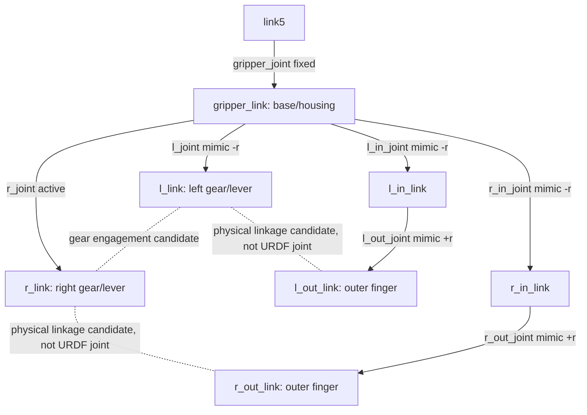

# C2.8 Gripper Assembly-Aware Collision Modeling

本轮起始 HEAD `46e8f730f652739284158bd183e3205d58c7e036`（C2.7/D1 已提交），分支 `feat/workspace-planning`。原有未跟踪 `docs/develop/` 和 `workspace_analysis/results.zip` 保留。起始实测 463 passed / 1 warning；最终回归 479 passed / 1 warning / 0 skipped，Native 1/1 PASS。

## 机构：URDF Tree 与实体关系分开

模型有一个额外的独立夹爪变量 r_joint，五个 Mimic 变量；机械臂仍是原五维 q。固定 gripper_joint 将夹爪安装到 link5。虚线只是来源 Mesh 和机构功能支持的候选解释，**没有给 FK 增加实体闭环约束**。Mimic 数值满足不代表传动啮合、实物闭环或装配干涉已经验证。

## 固定的 task_scope_v0

新配置 `config/collision/task_scope_v0.yaml` 与现有 ACM v1、Geometry Profile 独立。它只声明研究范围，不是正常接触安全许可，也没有修改 `assembly_policy_v1.yaml`。

| 显式内部诊断 Pair | 分类及依据 | 未验证问题 |
|---|---|---|
| gripper_link / r_in_link | 未解决内部接触；r_in_joint 直接连接、Mimic 驱动 | C2.7 接触延伸到远轴区域，可能有真实机械干涉 |
| gripper_link / l_in_link | 近轴关节/轴承接触候选；l_in_joint 直接连接 | 近轴证据不是整对安全许可；极端开度仍未验证 |
| l_in_link / l_out_link | 未解决的关节/连杆内部接触；l_out_joint | 接触既有近轴也有远轴，不能确认全部正常 |
| l_link / l_out_link | 传动联接候选；l_joint / l_in_joint / l_out_joint 两分支路径 | 实体闭环尺寸及闭合条件未标定 |
| l_link / r_link | 齿形啮合候选；l_joint / r_joint，两侧 Source Mesh 可见齿形 | 啮合接触和潜在干涉没有完整物理审核 |
| r_in_link / r_out_link | 未解决内部关节/连杆接触；r_out_joint | 远轴接触及闭环关系未确认 |
| r_link / r_out_link | 传动联接候选；r_joint / r_in_joint / r_out_joint | 闭环与局部接触模型未确认 |

其中六对为 C2.7 剩余持续接触，另将有明确近轴/父子证据的 gripper/l_in 列入官方几何研究范围。七对在本轮首次 Pilot 前固定，**没有依据候选比例追加**。Gripper 子树共七个 Link、21 对组合，其余 14 对仍受阻塞检测，不能因为同属 Gripper 就自动忽略。

Scope A：所有未被 ACM v1 允许、且不在七对诊断名单中的机器人 Self Pair。Scope B：七对的独立内部诊断。Scope C：官方完整 24 个 Collision Mesh 与 S1 全部 38 Box。Gripper Link 对环境、底盘和非内部 Link 的检测不受 Scope B 影响。

本轮采用 Official Full Geometry；没有继续删除三角面。可选 C2.7 Refined + Task Scope 对照未实现，v0 的 geometry_rule 明确 official_full_only，组合请求直接拒绝，避免悄悄切换几何。

## Native 实现与可信边界

协议仍为版本 1，QUERY 新增三个可选字段：task_scope_canonical_json、task_scope_sha256、task_scope_context。没有 SET_SCOPE 状态；每次都验证 Scope 的源 URDF、ACM 身份、完整查询上下文（含 Geometry、Scene、Backend）、成员集合、URDF 路径、机制候选标签及未验证因素。

只对当前请求创建临时矩阵：

1. 官方 Raw / Effective、环境查询保留原样。
2. 在 ACM v1 的局部副本中，仅增加七对研究范围过滤，重新执行真实 FCL Task Blocking 查询。
3. 构建只检查七对的独立内部诊断查询，记录实际接触。
4. Blocking、Internal 和 Environment 都另做 contacts=false 的完整布尔查询。候选不依赖有限 Contact Map；列表达到限制时只限制诊断完整性，不让其他阻塞 Pair 漏检。
5. 任务范围 Self Clearance 使用同一局部矩阵与 FCL GST_INDEP；环境 Clearance 保留官方完整几何。

没有改写全局 policy_acm_ 或 Scene ACM。合法 Scope 切换后下一条无 Scope 查询与原始结果相同。错误 Scope/Scene/Model/ACM/Hash 拒绝，不回退成无范围的“通过”。

返回 task_scope 子对象，并由 Evaluator 展开为：official_raw_self_collision、official_effective_self_collision、task_scope_blocking_self_collision、gripper_internal_collision、task_scope_candidate、task_scope_status、blocking/internal pairs、clearance、missing_coverage、model_scope_status。旧 raw_self_collision/effective_self_collision/model_scope_collision_free/final_decision 语义不变。

**Task Candidate 不会变成 CLEAR。** 合成验证夹具可以同时 Full Effective Self=true、Task Candidate=true、Final=COLLIDING、hardware_safe=null；这正是两个问题分别回答，而不是覆盖历史事实。

## 实际机构扫描

最终完整 21 对审计：`results/c2_8/assembly_allpairs_e7c61f/`。八个开度 -1.57、-1、-0.5、0、0.3、0.6、1、1.57 rad，加上 Sample 8/19/73。覆盖 URDF 两端、中间和既有参考状态；端点没有被声称为毫米级已标定的实物“完全收拢/张开”。

所有状态校验了 Mimic。源 Native Link Transform、FCL Contact/Depth、21 对独立 Collision/Distance、关节轴局部坐标、URDF 路径和分类均在 internal_contact_audit.json。有限接触集合始终标为 incomplete。

| 零位夹爪 r_joint | 显式诊断有接触 Pair 数 | Task Blocking Pair 数（含机械臂） |
|---:|---:|---:|
| -1.57 | 7 | 6 |
| -1.0 | 7 | 10 |
| -0.5 | 7 | 15 |
| 0 | 7 | 4 |
| 0.3 / 0.6 / 1.0 / 1.57 | 7 | 3 |

在负开度和零位可见额外的未声明夹爪 Pair 接触，例如 gripper/out、交叉连杆、外夹爪互碰；这些仍阻塞，不是新增的安全诊断许可。各 Pair 的具体角度、距离、深度和分类均可查询，不能仅按碰撞频率解释正常装配。

矩阵 HTML/PNG 中紫色是 **UNVERIFIED 内部诊断**，红色是未声明、仍阻塞的夹爪 Pair，灰色是该姿态未检出接触。原始七对审计 Run `assembly_8c417a` 保留，后续全 21 对另建 Run，没有覆盖。

## 正反例与测试

新增 16 项 Python 测试（含参数化真实 Native 案例），保留全部原 463 项。Native CTest 另增加内部碰撞仍保留、任务候选、cap=1 与范围不污染的独立 Box 正例：

- 独立 Box 机构夹具：仅声明的内部相交仍真实记录，Task Candidate 可为 true，完整机器人仍碰撞、机械状态仍 UNVERIFIED。
- Gripper/底盘、Gripper/Arm、Gripper/环境、未声明的 Gripper 内部 Pair 均仍拒绝。
- 接触列表上限设为 1，完整布尔查询仍检出外部阻塞，不产生假候选。
- 错误模型/ACM、成员、Pair、路径、虚假 validated 声明及 Scene 绑定均拒绝。
- Scope 切换、无 Scope 回读保持原状态；原 Collider/限位/Source FK 和 Mimic 不变。
- Sample 19 保留 back_shell_black_link/link3；8/73 保留全部环境碰撞。
- 官方 Source Viewer 全 24 Mesh、紫色实际内部点、独立阻塞/环境层与不覆盖机制正确。
- 100 配置端到端封装：原数组、统计守恒、结果身份、不覆盖；全部规模另做产物校验。

1,000 实际配置中，Gripper/环境 19 个、Gripper/底盘/外壳 96 个、Gripper/Arm 10 个（分类允许重叠）。代表性完整 Viewer：`results/c2_8/examples_9842ae/`，Index 8（环境）、2（底盘）、84（Arm）、19（折叠）、73（环境）。均从原始 q 重放并核对 Native 结果，未伪造候选。

## 可视化与状态

复用 C2.5 全机器人 Viewer，增加 Internal Diagnostic / Task Blocking 过滤、紫/红/橙接触层和单独的任务范围信息。完整模型事实同时显示。开度 close-up 只隐藏显示层，不改变任何碰撞查询，保留实际 Native Link Frames。

浏览器交互验收仍待用户执行；实际 Mesh/Contact Trace 和矩阵数据已检查，静态矩阵已视觉检查。没有以测试数量替代人工三维评审。

修改：C++ engine.cpp/main.cpp/tests/native_tests.cpp、collision/client.py/evaluator.py、viz/collision.py、README。新增 assembly.py、scope.py、task_scope_v0.yaml、experiments/task_scoped_workspace.py、audit_assembly.py/evaluate_task_workspace.py/check_task_workspace.py/export_task_examples.py、tests/test_task_scope.py 及两份文档。R1 依赖方向保持，没有新 FK、Scene Parser、FCL 实现或 Geometry 替换。

Software Implementation：完成。Task-Scoped Collision Validation：软件隔离/真实 Native 正反例通过；实际 JetRover 无候选，Scope A 装配/几何仍待审计。Gripper Internal Mechanical Validation：UNVERIFIED。Physical Hardware Validation：未执行。D2 Research Readiness：可用于可复现的范围拆分研究，不能作为全机器人安全认证或任务执行许可。

全部命令与 D2 统计见 [D2 文档](d2_task_scoped_workspace.md)。
